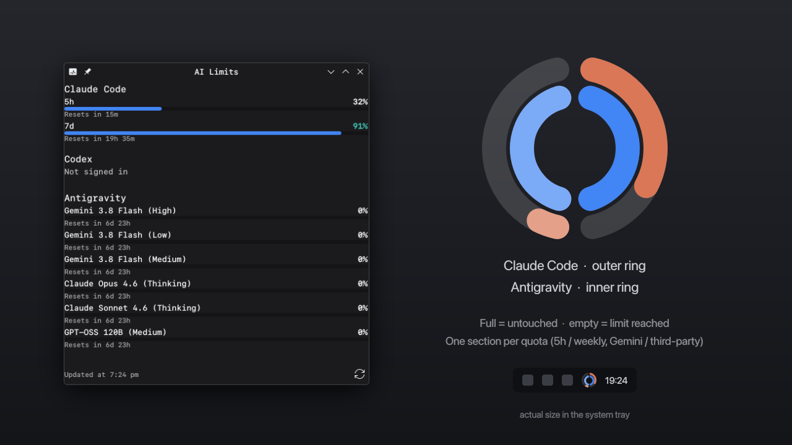

# lim

A KDE Plasma 6 system tray widget that shows how much of your AI coding assistant quota is left:
**Claude Code**, **Codex** (ChatGPT) and **Antigravity** (Gemini).



- The tray icon is a set of nested rings: Claude Code outside, Codex in the middle, Antigravity inside.
  Each ring has a section per quota (for example 5h and weekly). A full section means the quota is
  untouched, an empty one means it's used up.
- The popup shows every limit with a progress bar and the time until it resets.
- Read-only: it uses the logins those tools already store on your machine. No API keys, no extra accounts.

## How it works

```
main.qml ──runs every N min──▶ ai-limits.sh ──▶ JSON ──▶ popup / panel
```

The widget is plain QML. All data collection lives in one dependency-light Bash script
([`ai-limits.sh`](package/contents/code/ai-limits.sh)) that prints JSON, so you can run and test it on its own:

```bash
package/contents/code/ai-limits.sh claude codex antigravity
```

```json
{"updated":1761140000,"providers":[
  {"id":"claude","name":"Claude Code","limits":[{"label":"5h","used":42,"resets_at":1761141600,"group":"5h"}],"error":null}
]}
```

| Provider    | Credentials                                   | Source                                                         |
|-------------|-----------------------------------------------|----------------------------------------------------------------|
| Claude Code | `~/.claude/.credentials.json`                 | `GET api.anthropic.com/api/oauth/usage`                        |
| Codex       | `~/.codex/auth.json`                          | `GET chatgpt.com/backend-api/wham/usage`                       |
| Antigravity | CSRF token from the running language server   | `GetUserStatus` on the local language server (`127.0.0.1`)     |

For Antigravity, the script finds the `language_server` process in `/proc`, reads its CSRF token from the
command line, finds its listening ports through `/proc/<pid>/net/tcp`, and asks each port in turn.
`CLAUDE_CONFIG_DIR` and `CODEX_HOME` are respected. Tokens are passed to `curl` in a way that keeps
them out of the process list.

## Requirements

- KDE Plasma 6
- `bash`, `curl`, `jq`
- Logged in to the tools you want to track: `claude`, `codex login` (with ChatGPT), or a running Antigravity

## Install

```bash
git clone https://github.com/luminarysrc/lim.git
```

```bash
cd lim && kpackagetool6 -t Plasma/Applet -i package
```

It appears in the system tray by itself. If it doesn't, open *System Tray Settings → Entries* and set
**AI Limits** to *Always shown*. It isn't offered under *Add Widgets*: it's made for the tray only.
To update after changes, use `-u` instead of `-i`.

In the widget settings you can choose the refresh interval and which providers to show. Under **Appearance**:

- **Size:** ring size (40–100% of the tray icon) and line thickness (5–25% of the ring).
- **Colors:** one color per provider (Claude orange, Codex follows your theme's text color,
  Antigravity blue). Each section gets a shade of it, and any section's color can be overridden.
- **Sections:** hide quotas you don't care about. The remaining sections share the whole ring,
  and hidden ones still appear in the popup.

Limits that share one quota form one section. In Antigravity, the Gemini models share one quota
and the third-party models (Claude, GPT-OSS) another.

## Development

```bash
bash tests/test.sh
```

```bash
plasmoidviewer -a package
```

The tests cover the response parsers, the `/proc` parsing and the ring logic (`rings.js`, run with
Qt 6's `qmltestrunner` from `qt6-declarative`). CI runs them along with `shellcheck`.

```
package/
├── metadata.json                     tray-only: X-Plasma-NotificationArea, NoDisplay
└── contents/
    ├── code/ai-limits.sh             data collection (Bash + jq)
    ├── config/                       settings schema and pages
    ├── icons/lim-symbolic.svg        tray icon before the first data arrives
    └── ui/
        ├── main.qml                  state, refresh timer, script runner
        ├── CompactRepresentation.qml tray icon (nested rings)
        ├── Ring.qml                  one provider ring
        ├── rings.js                  sections, shades and visibility (tested)
        ├── configAppearance.qml      size, colors, hidden sections
        ├── ProviderAppearance.qml    one provider's colors and sections
        ├── FullRepresentation.qml    popup
        ├── ProviderSection.qml       one provider
        ├── LimitBar.qml              one limit
        └── format.js                 time and colour helpers
tests/
├── test.sh
└── tst_rings.qml
```

## Notes

- None of these usage endpoints are public APIs. They are what the official tools use internally,
  so they can change without notice.
- The widget never refreshes or rewrites tokens. If a Claude token has expired, run `claude` once and it renews itself.

## License

[MIT](LICENSE)
